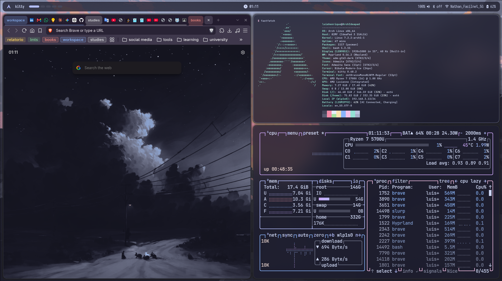

# Arch Linux Dotfiles

Personal Arch Linux dotfiles, built and configured entirely from scratch around Hyprland



## Stack

* Arch Linux
* Hyprland / Wayland
* SDDM
* Kitty
* Bash
* Waybar
* Rofi
* Mako
* Neovim
* Yazi
* Cava
* btop
* Wlogout
* Hyprpaper / Hyprshot
* Oh My Posh
* Iosevka Nerd Font

## Hyprland

The Hyprland configuration is written in Lua and split into small modules for keybindings, input, layout, decorations, monitors, window rules, environment, and startup.

```text
hypr/
├── hyprland.lua
├── hyprpaper.conf
└── modules/
    ├── autostart.lua
    ├── binds.lua
    ├── decorations.lua
    ├── env.lua
    ├── input.lua
    ├── layout.lua
    ├── misc.lua
    ├── monitors.lua
    └── windowrules.lua
```

## Structure

```text
.config/
├── btop/
├── cava/
├── clipse/
├── fastfetch/
├── gtk-3.0/
├── gtk-4.0/
├── hypr/
├── kitty/
├── mako/
├── nvim/
├── oh-my-posh/
├── rofi/
├── waybar/
├── wlogout/
├── xsettingsd/
└── yazi/
```

## Customization

The entire setup was configured by me from scratch according to my own workflow and preferences.

This includes custom configurations, scripts, themes, keybindings, window rules, and a fully customized Waybar created by me rather than using a pre-made configuration.

The overall aesthetic is based on Catppuccin Mocha, which I use as the main visual reference throughout the setup. This includes Hyprland, Waybar, Kitty, btop, Rofi, Mako and other applications.

## Installation

```bash
git clone https://github.com/YOUR_USERNAME/YOUR_REPOSITORY.git
```

Review the hardware-specific settings before using the configuration, especially:

```text
hypr/modules/monitors.lua
```
